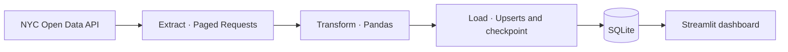

# NYC Urban Data Intelligence

A local data engineering portfolio project that incrementally ingests NYC 311 service requests, cleans them with Python and Pandas, stores them in SQLite, and charts them in Streamlit. The public API and local tools require no paid services or cloud account.

## Run locally

Use Python 3.12 and run these commands from the repository root.

```bash
python3.12 -m venv .venv
source .venv/bin/activate
python -m pip install -r requirements.txt
python -m nyc311.etl --page-size 1000
python -m streamlit run app.py --browser.gatherUsageStats false
```

Open [localhost:8501](http://localhost:8501). Filter by creation date, borough, or complaint category to explore the top complaint categories, borough counts, and daily trends. Stop Streamlit with **Control+C**. Re-run the ETL and reload the page to see newly collected records.

The database lives at `data/nyc311.sqlite3`. An existing V1 database gets upgraded automatically, with its records and dashboard preserved. `--page-size` accepts 1 to 5,000 rows per request. The ETL reads as many pages as the window needs.

## How incremental ingestion works

- **Track edits by source time.** `created_date` describes when the request was opened and is still used for charts. A request can be edited without changing that date. V2 queries the Socrata row modification field `:updated_at` and stores it as `source_updated_at` in UTC. `closed_date` refers to a specific workflow event and cannot track arbitrary edits. A dataset-wide refresh timestamp cannot identify which rows changed. [Socrata SoQL system field schema](https://github.com/socrata-platform/soql-reference/blob/da64f27ef51468ad003470ce38c80a3dc91f7126/soql-toy/src/main/scala/com/socrata/soql/SoqlToy.scala)
- **Read a fixed window.** The first run scans the last hour by default. Add `--since 2026-11-19T21:00:00Z` on a fresh database to choose a repeatable starting point. If that first run fails, reuse the same `--since` value. After the first success, omit it. Later runs start 10 minutes before the stored watermark and advance it by at most one day per run. If you are behind, repeat the command to catch up.
- **Page by timestamp and ID.** Each page starts after the prior page's last pair of modification time and numeric request ID. This lets several rows share a timestamp across page boundaries without being skipped on that account. Request timeouts and at most two retries keep transient failures bounded.
- **Commit together.** SQLite inserts new IDs and updates existing ones without duplicating them. The cleaned rows, latest quality counts, and checkpoint commit in one transaction after all API pages succeed. An empty scan can advance the watermark. A page or write failure leaves the previous committed state intact.

The quality log reports fetched, accepted, rejected, new, updated, and unchanged counts, plus the last successful run time. Rejected includes unusable payloads and duplicate versions discarded within a scan. Updated means a stored dashboard field changed. An unchanged row can still receive a newer source timestamp. The database keeps the most recent successful run's metrics in `ingestion_state`, while logs show individual attempts.

**Coverage limits.** The 10-minute overlap helps recover rows that appear shortly after a scan. Longer delays, source deletions, and time before the first scan may be missing. Invalid cursor fields stop the scan. Other invalid fields are counted and skipped if the batch contains valid rows. An entirely rejected batch stops without advancing. The dashboard shows the locally collected rows, which may include partial days.

## Architecture



| File | Role |
| --- | --- |
| `nyc311/extract.py` | Reads pages in modification order with explicit timeouts and bounded retries. |
| `nyc311/transform.py` | Validates required fields, normalizes boroughs, and deduplicates the sample. |
| `nyc311/storage.py` | Upserts records and saves a checkpoint in one transaction. Exposes read-only dashboard queries. |
| `nyc311/etl.py` | Runs the stages in order, logs record counts and failures, and returns a nonzero exit code on failure. |
| `app.py` | Reads SQLite and renders filters and charts. |

## How this maps to AWS

The application runs locally. These AWS services illustrate how the design could evolve.

| AWS service | Related design choice |
| --- | --- |
| Lambda | The command-line ETL could become a function invoked on a schedule. |
| EventBridge Scheduler | A recurring schedule could trigger the Lambda ETL and let it resume from its checkpoint. |
| S3 | A raw-data archive could save API pages as objects for replay. The local pipeline processes pages in memory. |
| RDS | A managed relational database could replace the local SQLite file when multiple processes need shared access. The primary key would still enforce request uniqueness. |
| IAM | A function role could grant the ETL access to only its bucket and other required resources. The local pipeline uses the public API and local filesystem permissions. |
| CloudWatch | The ETL's logs could be collected centrally to track record counts and alert on failed runs. |

## Tests and verification

```bash
python -m unittest discover -v
```

All 18 tests passed in the development environment, including the original nine. The V2 tests cover new and modified records, repeated runs, equal timestamps across pages, retries, partial failures, empty results, and checkpoint rollback. They mock HTTP and use temporary databases.

**Live verification.** V1 ingestion and the dashboard were verified on macOS. The V2 query could not reach NYC Open Data from the cloud development environment because its proxy returned HTTP 403. Socrata's schema identifies `:updated_at` as a system timestamp, but the V2 query and timestamp format still need a live check on dataset `erm2-nwe9`. From a network that can reach NYC Open Data, run this read-only probe. Look for a `source_updated_at` value with a UTC offset or `Z`.

```bash
curl --fail --get 'https://data.cityofnewyork.us/resource/erm2-nwe9.json' \
  --data-urlencode '$select=unique_key,created_date,:updated_at AS source_updated_at' \
  --data-urlencode '$order=:updated_at DESC, unique_key::number DESC' \
  --data-urlencode '$limit=1'
```

See [the learning guide](LEARNING_GUIDE.md) for a macOS walkthrough and explanations of each stage. [NYC 311 dataset](https://data.cityofnewyork.us/d/erm2-nwe9)
