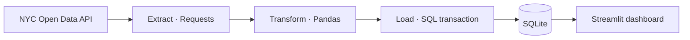

# NYC Urban Data Intelligence

A local data engineering portfolio project that samples NYC 311 service requests, cleans them with Python and Pandas, stores them in SQLite, and charts them in Streamlit. The public API and local tools require no paid services or cloud account.

## Run locally

Use Python 3.12 and run these commands from the repository root.

```bash
python3.12 -m venv .venv
source .venv/bin/activate
python -m pip install -r requirements.txt
python -m nyc311.etl --limit 1000
python -m streamlit run app.py --browser.gatherUsageStats false
```

Open [localhost:8501](http://localhost:8501). Filter by creation date, borough, or complaint category to explore the top complaint categories, borough counts, and daily trends. Stop Streamlit with **Control+C**. Re-run the ETL and reload the page to see newly collected records.

The ETL requests the newest records from dataset `erm2-nwe9`, ordered by creation time and request ID. Each run accepts a limit from 1 to 5,000. The database lives at `data/nyc311.sqlite3` by default. Each run adds new IDs and preserves the first stored version of each request. Totals describe the locally collected sample. The oldest day in a sample can be partial, and dates with no matching stored requests are omitted from the trend.

## Architecture



| File | Role |
| --- | --- |
| `nyc311/extract.py` | Fetches the four dashboard fields with an explicit timeout and checks the HTTP response. |
| `nyc311/transform.py` | Validates required fields, normalizes boroughs, and deduplicates the sample. |
| `nyc311/storage.py` | Inserts rows in a transaction, enforces unique IDs, and exposes read-only queries. |
| `nyc311/etl.py` | Runs the stages in order, logs record counts and failures, and returns a nonzero exit code on failure. |
| `app.py` | Reads SQLite and renders filters and charts. |

## How this maps to AWS

The application runs locally. These AWS services illustrate how the design could evolve.

| AWS service | Related design choice |
| --- | --- |
| Lambda | The command-line ETL could become a function invoked on a schedule. |
| S3 | A future raw-data archive could save API responses as objects for replay. The MVP transforms each response in memory. |
| RDS | A managed relational database could replace the local SQLite file when multiple processes need shared access. The primary key would still enforce request uniqueness. |
| IAM | A function role could grant the ETL access to only its bucket and other required resources. The MVP uses the public API and local filesystem permissions. |
| CloudWatch | The ETL's logs could be collected centrally to track record counts and alert on failed runs. |

## Tests and verification

```bash
python -m unittest discover -v
```

All nine tests passed in the development environment. They cover query construction, validation, duplicate prevention across runs, rollback, HTTP failure handling, and dashboard rendering and filters. The tests use mocked HTTP responses and temporary SQLite files, so they work offline after dependencies are installed.

**Live local verification (November 19, 2026):** Running `python -m nyc311.etl --limit 50` on macOS successfully fetched 50 NYC 311 requests, rejected 0 invalid rows, removed 0 within-batch duplicates, and inserted 50 records into SQLite. The Streamlit dashboard showed 50 requests and its borough filter updated the charts correctly. All 9 unittest tests passed locally. The GitHub Actions `Python tests` CI job also succeeded for commit `d6ef4ac`. Earlier, the Codex cloud proxy blocked a direct NYC Open Data request (HTTP 403); this was a limitation of that environment, not the successful local run.

**Known MVP limitations:** Each ETL run samples the latest requests rather than maintaining a historical cursor or backfill; existing IDs are preserved without updating changed source records. Charts reflect the stored sample, not all NYC requests. Future work will add incremental ingestion, upserts, and quality checks.

See [the learning guide](LEARNING_GUIDE.md) for a macOS walkthrough and explanations of each stage. [NYC 311 dataset](https://data.cityofnewyork.us/d/erm2-nwe9)
